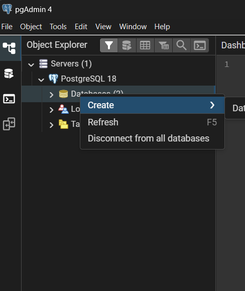
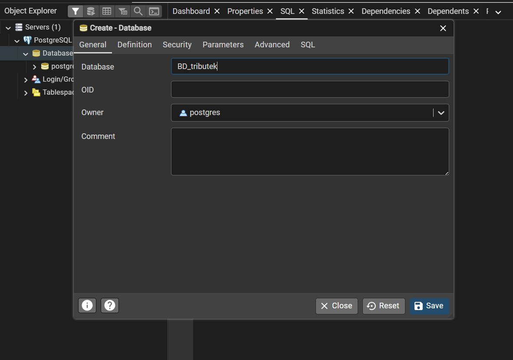

# PostgreSQL y variables locales

El backend se conecta a PostgreSQL mediante Prisma 8 y la variable
`DATABASE_URL`. `src/prisma/db.ts` carga `.env` desde el directorio de trabajo
y detiene el inicio si la URL no existe. Para que encuentre
`tributek/backend/.env`, ejecuta el backend desde `tributek/backend`.

`prisma.config.ts` también carga las variables de `.env` para los comandos de
Prisma y usa la misma `DATABASE_URL` como conexión.

## Preparar el entorno local

1. Instala las dependencias del backend según las instrucciones del [README
   principal](../../../../README.md).
2. Inicia el servidor local de PostgreSQL y crea una base de datos de desarrollo
   vacía. Prisma se conecta a una base existente; no instala ni inicia el
   servidor PostgreSQL. Crea la base manualmente con `psql`:

```powershell
psql -U postgres -c "CREATE DATABASE BD_TRIBUTEK;"
```

   Reemplaza `postgres` por tu usuario de PostgreSQL y `BD_TRIBUTEK` por el
   nombre de base que uses en `DATABASE_URL`.

   **Alternativa con pgAdmin** (si no tienes `psql` en el PATH): abre pgAdmin,
   expande el servidor conectado en el árbol de navegación, haz clic derecho
   sobre "Databases" -> "Create" -> "Database…", escribe `BD_TRIBUTEK` en el
   campo "Database" y acepta. Si no ves el servidor, primero conéctate a él
   (clic derecho en el servidor -> "Connect Server").




3. Crea `tributek/backend/.env` (está excluido de Git) con tus valores locales:

```env
DATABASE_URL="postgresql://<contraseña>@localhost:5432/<nombre_base_de_datos>"
JWT_SECRET="<secreto-local-largo-y-aleatorio>"
```

`DATABASE_URL` es necesaria para la conexión a datos. `JWT_SECRET` firma y
verifica los tokens de autenticación. `PORT` es opcional; el backend usa `3001`
si no está definido. No subas `.env` ni secretos reales al repositorio.

4. Desde la raíz del repositorio, inicia el backend en modo desarrollo:

```powershell
npm run start:dev --prefix tributek/backend
```

El servicio carga la configuración al iniciar e intenta conectar con la base
indicada en `DATABASE_URL`. No se verificó una conexión a una base local como
parte de esta guía.

## Crear las tablas de una base local nueva

El contrato fuente está en `tributek/backend/prisma/contract.prisma`. Los
archivos `contract.json` y `contract.d.ts` se emiten desde ese contrato y no se
editan manualmente. Si se modificó el contrato, primero emite los artefactos:

```powershell
cd tributek/backend
npx prisma contract emit
```

Para inicializar únicamente una base local vacía, revisa primero el plan:

```powershell
npx prisma db init --dry-run
```

Si la URL apunta a la base local correcta y el plan es el esperado, puedes
aplicar la inicialización:

```powershell
npx prisma db init
```

`db init` crea de forma aditiva las estructuras que faltan y firma la base con
el contrato. No lo ejecutes contra una base compartida, con datos importantes o
de estado desconocido sin coordinarlo con el equipo. Si la base ya existe, no
asumas que necesita inicialización: primero determina su estado y el flujo de
migración acordado.

Para comprobar una base ya inicializada:

```powershell
npx prisma db verify
```

`db verify` consulta la marca y el esquema; no crea ni actualiza tablas. Puede
fallar si la base no tiene la marca, el contrato emitido no está presente o la
conexión no es accesible.

Consulta [Flujo del contrato Prisma](flujo-prisma.md) antes de modificar modelos
o aplicar cambios a una base compartida.

## Imágenes de referencia

Coloca las capturas en `tributek/docs/img/` y referencialas desde aquí:

| Imagen | Ruta sugerida | Qué muestra |
|--------|---------------|-------------|
| pgAdmin: conectar servidor | `../img/pgadmin-conectar-servidor.png` | Clic derecho en servidor -> Connect Server |
| pgAdmin: crear base de datos | `../img/pgadmin-crear-base-datos.png` | Clic derecho en Databases -> Create -> Database… |
| pgAdmin: nombre de la base | `../img/pgadmin-nombre-base.png` | Campo "Database" con `BD_TRIBUTEK` |
| Prisma: dry-run | `../img/prisma-db-init-dry-run.png` | Salida de `npx prisma db init --dry-run` |
| Prisma: aplicar | `../img/prisma-db-init.png` | Ejecución de `npx prisma db init` |
| Prisma: verificar | `../img/prisma-db-verify.png` | Resultado de `npx prisma db verify` |


## Referencias

- [Contrato de datos de Prisma ORM](https://www.prisma.io/docs/orm/contract-authoring/the-data-contract)
- [Inicializar una base de datos](https://docs.prisma.io/docs/cli/db-init)
- [Verificar una base de datos](https://www.prisma.io/docs/cli/db-verify)
