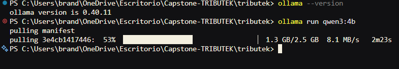

# Preparar Ollama para TRIBUTEK

Esta guía explica cómo instalar Ollama y probar un modelo local antes de conectarlo con TRIBUTEK. Las consultas del navegador pasan por el backend; el frontend no se conecta directamente a Ollama.

## Cómo se conecta el asistente

El flujo previsto es:

1. La persona escribe una consulta en el chat de TRIBUTEK.
2. El frontend la envía al backend NestJS con la sesión autenticada.
3. El backend envía la consulta a Ollama.
4. Ollama genera la respuesta y el backend la devuelve al frontend.

Así, la URL del servicio local y el modelo quedan configurados en el backend.

## Instalar Ollama en Windows

Descarga el instalador desde [ollama.com](https://ollama.com/download/windows) y sigue las instrucciones. Luego abre PowerShell y comprueba que el comando esté disponible:

```powershell
ollama --version
```

## Descargar y probar el modelo

Para descargar Qwen 3 de 4 mil millones de parámetros e iniciar una sesión interactiva, ejecuta:

```powershell
ollama run qwen3:4b-instruct
```

Escribe una pregunta en la sesión para comprobar que el modelo responde. Puedes revisar los modelos descargados con:

```powershell
ollama list
```

Para salir de la sesión interactiva, escribe:

```text
/bye
```



Al evaluar el modelo, revisa la claridad de las respuestas en español, el tiempo que tarda y el consumo de recursos del equipo. El rendimiento puede variar según la memoria disponible y cuánto trabajo se ejecute en CPU o GPU.

## Siguiente paso

Con Ollama disponible, configura y ejecuta la integración del backend descrita en [Integración de IA en el backend](02-Integracion-ia-backend.md). Si Ollama deja de estar disponible, consulta allí [cómo activar manualmente el servicio y cargar el modelo](02-Integracion-ia-backend.md#activar-el-servicio-de-ia). Esta activación es temporal; se espera automatizarla más adelante. La interfaz del chat se describe en [Asistente IA en el frontend](03-integracion-frontend.md).
